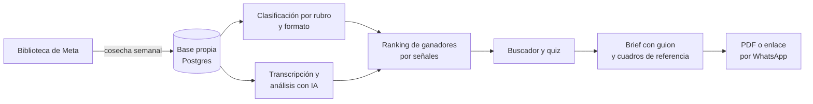

# 1000% Ads · Inteligencia creativa para anunciantes de LATAM

> **Encontramos el anuncio ganador que hoy no estás haciendo y te ayudamos a armar el tuyo.**

1000% Ads es un SaaS que recolecta cada semana los anuncios activos de la Biblioteca de Anuncios de Meta en Perú y la región. Los ordena por las señales públicas de que están funcionando, explica con IA por qué funcionan y arma un brief para que cada negocio produzca su propia versión.

Este repositorio es la **vitrina técnica** del proyecto. El código de la plataforma es privado. Aquí están la arquitectura, las decisiones de diseño, los números reales y dos piezas abiertas que puedes usar.

🔗 Producto en vivo: [app.1000porcientoads.com](https://app.1000porcientoads.com)

---

## En números (20 de noviembre de 2026)

| | |
|---|---|
| Anuncios recolectados | **18.401** |
| Anuncios activos hoy | **11.287** |
| Marcas anunciantes | **6.004** |
| Rubros clasificados | **25** |
| Llamadas a modelos de IA en el último mes | **2.909**, por **US$ 3,48** en total |
| Commits en el repositorio privado | **428**, desde julio de 2026 |
| Código | ~64.000 líneas de TypeScript |

Los números salen de la base de producción. El producto está en etapa temprana: hay usuarios activos y todavía no hay ingresos recurrentes. Se cuenta así, sin inflar nada.

---

## Qué hace



1. **Tu marca.** Pegas tu web o tus redes y la IA arma la ficha de marca: tono, oferta y público.
2. **Buscar.** Escribes lo que vendes y ves los anuncios ganadores de tu rubro.
3. **Entender.** La IA explica el gancho, la estructura y las señales de que funciona.
4. **Brief.** Guion por partes (gancho, problema, oferta, prueba y cierre), con los cuadros del anuncio de referencia.
5. **Compartir.** En PDF o por enlace de WhatsApp para quien graba o diseña.

---

## Marca

Un universo gráfico completo, diseñado desde cero: sistema visual (logotipo, paleta, tipografía y reglas de uso), un personaje de marca, **Mil**, modelado en 3D, que guía al usuario dentro del producto y protagoniza los anuncios, y una voz y un tono propios: español neutro y cercano, con el dolor dicho en las palabras del cliente y sin promesas que el producto no cumple. El mismo sistema se aplica en la web, la plataforma, los videos y los correos.

---

## IA, MCP y automatización

- **Conector MCP propio.** Un servidor MCP para que Claude y otros asistentes de IA consulten la base de anuncios con la cuenta del usuario. El acceso por llave ya funciona; la versión con OAuth, pensada para directorios de conectores, revisa el plan en cada llamada y corta el acceso si la persona deja de pagar. Está probada y todavía no se publica.
- **IA con respaldo.** Gemini, Groq, OpenAI, DeepSeek, OpenRouter y Anthropic detrás de una sola capa. Si un modelo falla o llega a su límite, la llamada pasa al siguiente, y cada uso queda registrado con sus tokens y su costo.
- **Flujos automáticos.** 16 procesos programados: cosecha de anuncios y marcas, transcripción, lecciones, limpieza, cobros con tarjeta, recordatorios y resumen diario. Mensajes de WhatsApp por una bandeja de salida que procesa n8n, correos transaccionales con sus eventos y respaldo diario de la base.

---

## Arquitectura

Ver [`docs/arquitectura.md`](docs/arquitectura.md).

- **Web:** Next.js 16 (App Router, Server Actions) y React, desplegado en Vercel.
- **Datos:** Supabase (Postgres) con migraciones versionadas, más una capa de almacenamiento en Cloudflare R2 para los medios destacados.
- **Cosecha:** procesos programados que leen la Biblioteca de Meta, deduplican anuncios, detectan el formato y guardan su historia.
- **IA:** varios proveedores con respaldo automático. Si uno falla o llega a su límite, la llamada pasa al siguiente, y cada llamada queda registrada con sus tokens y su costo.
- **Pagos:** Mercado Pago (tarjeta guardada y suscripción) en soles, abierto a cualquier país.
- **CRM propio:** contactos, eventos, correo transaccional y WhatsApp por bandeja de salida con n8n.
- **Conector MCP con OAuth:** para que asistentes de IA consulten la base con la cuenta del usuario (en desarrollo).

## Decisiones de diseño

Ver [`docs/decisiones.md`](docs/decisiones.md): por qué una base propia en lugar de consultar a Meta en vivo, cómo se mide un «ganador» sin ver las métricas privadas del anunciante, por qué el producto es *done with you* y no *done for you*, y cómo se trabaja en producción sin romper nada.

---

## Piezas abiertas

Dos utilidades sacadas del producto, reescritas para usarse solas, sin dependencias y con pruebas.

| Pieza | Para qué sirve |
|---|---|
| [`src/leer-json-ia.ts`](src/leer-json-ia.ts) | Lee el JSON que devuelve un modelo de lenguaje aunque venga con texto alrededor o comas sobrantes. Nació de un error real en producción. |
| [`src/senales-ganador.ts`](src/senales-ganador.ts) | Puntúa un anuncio de la Biblioteca de Meta con señales públicas (días activo, versiones, inversión sostenida de la marca, landing única) y explica el puntaje en frases. |

```bash
npm test
```

Las pruebas usan el ejecutor de pruebas de Node (22 o superior), sin instalar nada.

---

## Licencia

Las piezas de `src/` se publican con licencia [MIT](LICENSE). La marca, el producto y los datos de 1000% Ads no están incluidos.

---

<sub>English summary: 1000% Ads is a creative-intelligence SaaS for advertisers in Latin America. It harvests active Meta Ad Library ads every week, ranks them by public performance signals, explains with AI why they work and generates a production brief. This repo is the technical showcase; the platform code is private. Two small open utilities with tests live in `src/`.</sub>
