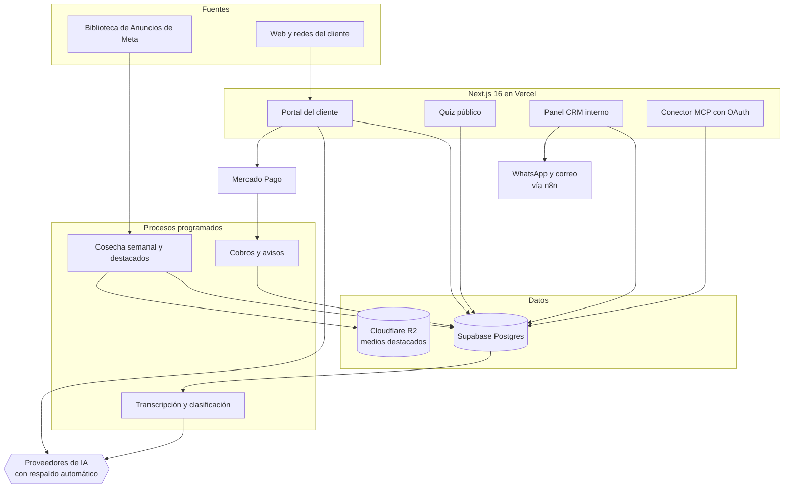

# Arquitectura

## Capas

**Datos.** Postgres en Supabase con migraciones versionadas. La tabla central guarda cada anuncio con su página, texto, formato, fechas, número de versiones y si sigue activo. Una vista de anuncios únicos deduplica copias del mismo creativo. Los medios de los anuncios destacados se guardan en Cloudflare R2, porque los enlaces de Meta vencen.

**Cosecha.** Procesos programados leen la Biblioteca por país y rubro, actualizan qué sigue activo y marcan la última vez que se vio cada anuncio. Un tope diario controla el gasto en el proveedor de datos.

**IA.** Toda llamada pasa por una sola capa que elige proveedor y modelo, reintenta con otro si el primero falla o llega a su límite, y registra tokens y costo por llamada. Así el costo de servir se conoce al centavo: 2.909 llamadas por US$ 3,48 en el último mes.

**Web.** Next.js 16 con App Router y Server Actions. El portal del cliente, el quiz público de entrada y el panel interno comparten la misma base. Cada cambio se publica desde una copia limpia del repositorio y se revisa en vivo a 375 px de ancho antes de darlo por hecho.

**Pagos y CRM.** Mercado Pago con tarjeta guardada y prueba gratis. Un CRM propio registra contactos y eventos del embudo; los mensajes de WhatsApp salen por una bandeja que procesa n8n, y los correos transaccionales por un proveedor de correo.

**Conector MCP.** Un servidor MCP con OAuth deja que asistentes de IA consulten la base con la cuenta y el plan del usuario. Cada llamada vuelve a leer el plan, así que el acceso se corta solo si la persona deja de pagar.
